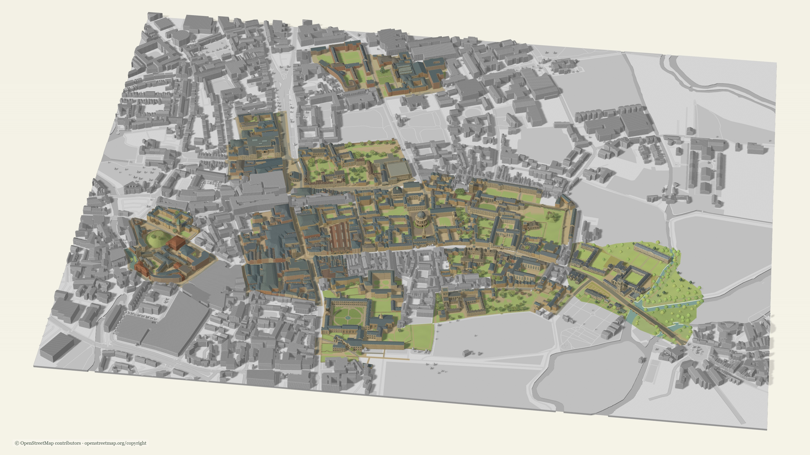
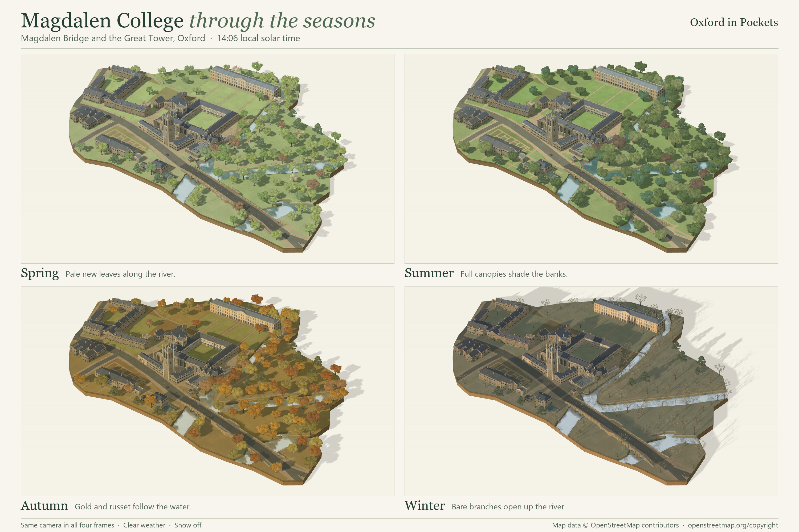

# Oxford in Pockets

**An illustrated 3D Oxford you can explore offline. Four seasons, fourteen neighbourhoods, one HTML file.**

[Download ZIP](https://github.com/Czwu013/Oxford-in-Pockets/archive/refs/heads/main.zip) · [Open the map](#open-the-map) · [中文说明](README.zh-CN.md) · [Labelled city panorama](docs/oxford-labelled.jpg)



*Central Oxford from above, from the Castle to Magdalen Bridge.*

<!-- Optional: add a “Watch the trailer” link here once the public video or X post URL is available. -->

## It started with a view from Magdalen Bridge

I wanted to see how Oxford changes through the year without moving the camera: new leaves along the Cherwell in spring, deep green canopies in summer, copper foliage in autumn, and bare branches that open up the view in winter. That first view grew into fourteen small neighbourhoods you can explore in a browser.

[](docs/magdalen-four-seasons.jpg)

*Same viewpoint, four seasons. [More views in the Magdalen gallery](docs/magdalen-gallery.html). Download the repository to open the gallery in your browser.*

## From the skyline to the pavement

Start above the city, then pick a neighbourhood to see it on its own. Follow the mapped High Street crossing between The Queen’s College and University College, or take the Broad Street walk between Balliol and Trinity. Look up near the Museum of Natural History for nesting swifts in spring and summer. At Magdalen’s Great Tower, a May Morning scene plays an original synthesised choir.

The street layout and building outlines follow OpenStreetMap. College plans and photographs informed the landmarks; heights and details without reliable measurements are artistic estimates. The [architectural sources](SOURCES.md) and [asset credits](CREDITS.md) distinguish mapped details from those estimates.

## Open the map

[Download the ZIP](https://github.com/Czwu013/Oxford-in-Pockets/archive/refs/heads/main.zip), extract it and open `docs/index.html` in a browser with WebGL 2. On GitHub, the file view displays the HTML source. For an online version, deploy the `docs/` folder with GitHub Pages. The map, geometry, textures and synthesised audio are embedded in the file and work offline. The interface opens in English. Choose **中 / EN** to switch to Chinese. The browser remembers your choice when local storage is available.

- On a computer, drag to orbit, scroll to zoom and Shift-drag or right-drag to pan. On a touch screen, drag with one finger and pinch or pan with two.
- For a clear view, choose the camera in the top right. **Photo mode** fills the window and lets you keep framing the scene as it runs. Choose **Show controls** in the top left or press **Esc** to return.
- Select a coloured building, its map label or a place in the bottom bar. On a phone, use the neighbourhood picker above the seasons.
- Choose **Pocket only** to see the selected neighbourhood from the same camera. **Fit pocket** frames its complete terrain section. **Full map** restores the surroundings. **City** returns to your previous city view.
- Switch seasons by hand or turn on the automatic cycle under **Weather**. Wet pavement, accumulating snow, shafts of light and day/night have their own controls. Event audio starts muted.

## Walk across the High

On the north side, **The Queen’s College & Queen’s Lane** includes the low High Street screen, Queen Caroline’s cupola, the arcaded Front Quad, the separate bell turret beside the Chapel and Hall, the library, St Edmund Hall and its former church of St Peter-in-the-East. The pocket covers 32 mapped building outlines.

On the south side, **University College & Logic Lane** includes the two High Street gate towers, Main Quad, Radcliffe Quad, the covered bridge over the lane, the Durham Buildings, street-front shops and the Examination Schools. The pocket covers 52 mapped building outlines.

Select **Walk to Univ** from Queen’s, or **Walk to Queen’s** from Univ. The camera follows the same mapped pedestrian crossing and southern pavement in both directions. A parallel pair of walks connects Balliol and Trinity on Broad Street.

## Places

| | Neighbourhood | | Neighbourhood |
| --- | --- | --- | --- |
| 1 | Magdalen College, the bridge and Addison’s Walk | 8 | Carfax and Oxford Town Hall |
| 2 | Radcliffe Square and the Bodleian | 9 | New College and the medieval city wall |
| 3 | Covered Market and Golden Cross | 10 | Merton College and Merton Street |
| 4 | Christ Church and Tom Quad | 11 | Balliol and west Broad Street |
| 5 | Museum of Natural History and the museum quarter | 12 | Trinity and east Broad Street |
| 6 | Oxford Castle and the old prison | 13 | The Queen’s College and Queen’s Lane |
| 7 | Ashmolean Museum and St Giles’ | 14 | University College and Logic Lane |

Spring and summer bring swifts to the Museum of Natural History’s roof nests. Magdalen’s Great Tower hosts a May Morning scene with an original synthesised choir. Great Tom and the Covered Market have their own events.

## Build

Use Node.js 20 or newer with npm. The lockfile pins the dependencies. All mapped geometry and render meshes are included.

```sh
npm ci
npm run build
```

Open `dist/index.html`. To choose another filename, run `node build.mjs path/to/oxford.html`. A web server and map-service credentials are unnecessary for the built application.

To refresh the copy for GitHub Pages, run `npm run build:pages`. The repository already includes a working site in `docs/`. In repository **Settings → Pages**, choose **Deploy from a branch**, then your default branch and **/docs**. The map and gallery both work under a project-specific URL.

| Source | Purpose |
| --- | --- |
| `geo/`, `src/data/` | Offline OSM extract, geography compiler and prepared map |
| `src/high-street.js`, `src/broad-street.js` | Architecture, public realm and gardens of the two walkable pairs |
| `src/magdalen/` | Original Magdalen pocket, its materials, ecology, weather and music |
| `src/quarters.js`, `src/pocket-scope.js` | Neighbourhood ownership, city rendering and individual terrain sections |
| `src/data/views.js`, `src/navigation.js` | Camera settings, walk paths, orbit and touch input |
| `src/language.js`, `page.html`, `style.css` | Interface, translations and portrait controls |
| `models/`, `src/assets/` | Six Oxford Atlas landmarks, their editable Blender sources (including both Tom Tower studies) and their compressed render meshes |

To rebuild the mapped quarters from the bundled extract, install Python with Shapely 2.1 and run `python geo/prepare-quarters.py`. To check the resulting plans and walk the built file in Chromium:

```sh
python scripts/verify-quarters-plan.py --out verification/quarters-plan.json
node scripts/verify-fourteen.cjs dist/index.html verification/browser
```

The browser check needs Playwright and Chromium. Set `POCKET_PLAYWRIGHT` and `POCKET_BROWSER` to use existing installations. The [verification folder](verification/) includes the geometry and browser reports from the release build. Mobile checks used touch emulation.

## Magdalen gallery

Open [the English image gallery](docs/magdalen-gallery.html) after downloading the repository, or view it on GitHub Pages if you have deployed the site. It includes thirteen images, including model views and a measured site-plan comparison, a [3000 × 2000 four-season print](docs/magdalen-four-seasons.jpg), and [instructions for editing the gallery](tools/gallery/README.md). [Labelled city panorama](docs/oxford-labelled.jpg)

## Credits and release terms

Plan geometry follows OpenStreetMap. Heights without a surveyed value, façade proportions, sculpture, furnishings and some planting are artistic estimates. The application and original authored portions of the landmark meshes are offered under MIT. OpenStreetMap data retains its ODbL licence. Credits for embedded CC0 scans and terrain-derived heights accompany the models. The high-street photographs and college plans were references for modelling. The project name and map describe an independent illustration of Oxford. [Credits and licences](CREDITS.md) · [Architectural sources](SOURCES.md) · [Model provenance](models/PROVENANCE.md)

